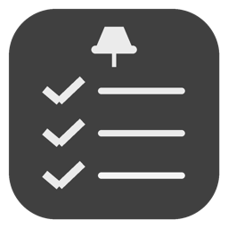

<div align="center">



# Desktop Notes

Sticky notes and full-screen reminders for your Windows desktop.

**English** | [Русский](README.ru.md)

[](https://github.com/ArtloK-7516405/DesktopNotes/releases/latest)

[](LICENSE)

</div>


[Notes](assets/screenshot-notes.png)
[Reminder](assets/screenshot-alarm.png)

## Features

- **Checklist notes** – add items with `+`; click the pencil next to an item to cross it out and dim it (click again to undo).
- **Reminder notes** – pick a date and time, write a description. When the time comes the screen dims, a big card appears and an alarm sounds.
- **Pin / unpin** – a pinned note stays on the desktop under all windows and can't be moved. An unpinned note floats above windows and can be dragged anywhere.
- **Create from the desktop** – right-click the desktop → *Create note* / *Create reminder*. The note appears under the cursor.
- **Auto-sizing** – notes get narrower or wider depending on their text.
- **Customisation** – 6 built-in themes plus your own (choose a background colour and an elements colour), any installed font and size, custom alarm sound (mp3 / wav), date format `DD.MM.YYYY` or `MM.DD.YYYY`.
- **Masked date and time fields** – the `00.00.0000` / `00:00` format can't be broken; deleted digits become `0`.
- **Lives in the tray** like a PowerToys module, optional autostart, single instance.

## Installation (for users)

1. Open the [**Releases**](https://github.com/ArtloK-7516405/DesktopNotes/releases/latest) page.
2. Download **`DesktopNotes-Setup.exe`**.
3. Run it and follow the wizard (no administrator rights needed – it installs for the current user).
4. Keep *Launch Desktop Notes* ticked on the last page. An icon appears in the system tray.

> **"Windows protected your PC" (SmartScreen)?** The installer is not code-signed, so Windows may warn you. Click **More info → Run anyway**.

Requirements: Windows 10 / 11, 64-bit. .NET is bundled – nothing else to install.

## How to use

| I want to… | Do this |
|---|---|
| Create a note | Right-click the desktop → **Create note** (or tray icon → *New note*) |
| Create a reminder | Right-click the desktop → **Create reminder** |
| Move a note | Drag it (it must be unpinned) |
| Pin / unpin | Click the pin icon at the top of the note |
| Delete a note | Click `×` in the top-right corner |
| Snooze an alarm for 5 min | Click `–` on the alarm card |
| Dismiss an alarm | Click `×` or press `Esc` |
| Open settings | Double-click the tray icon, or Start menu → *Desktop Notes* |

### Windows 11: where is "Create note"?

Windows 11 hides third-party items in the desktop menu under **Show more options** (or press **Shift + right-click**).
To see them right away, open *Settings* and tick **"Show 'Create note' directly in the desktop menu"** – this switches the whole system to the classic Windows 10 context menu (Explorer restarts). Untick it to revert.

### Where is my data?

`%AppData%\DesktopNotes\data.json` – notes and settings. Copy this file to move your notes to another PC.

### Uninstall

*Settings → Apps → Installed apps → Desktop Notes → Uninstall*. Menu entries and autostart are removed automatically. Your notes in `%AppData%\DesktopNotes` are kept.

## Build from source

You need [.NET 8 SDK](https://dotnet.microsoft.com/download/dotnet/8.0) and [Inno Setup 6](https://jrsoftware.org/isdl.php).

```bat
git clone https://github.com/ArtloK-7516405/DesktopNotes.git
cd DesktopNotes
build.bat
```

The installer will be at `installer\DesktopNotes-Setup.exe`. To only run the app during development:

```bat
dotnet run --project src\DesktopNotes.csproj
```

### Project structure

```
src/                 C# (WPF, .NET 8) sources
  Program.cs         entry point, tray, single instance, alarm timer
  NoteWindow.cs      the note window (list / reminder)
  AlarmWindow.cs     full-screen reminder
  SettingsWindow.cs  settings
  Mask.cs            masked date/time input
  Integration.cs     desktop menu, autostart (registry, HKCU)
  Models.cs          data, themes, storage
  AlarmSound.cs      alarm sound
installer.iss        Inno Setup script
build.bat            one-click build
.github/workflows    automatic release build
```

## Troubleshooting

- **`build.bat`: "NuGet.Protocol ... not found"** – the .NET SDK installation is corrupted. Uninstall all .NET SDKs, delete `C:\Program Files\dotnet\sdk`, reinstall .NET 8 SDK, check `dotnet --version`.
- **Menu items don't appear on the desktop** – see the Windows 11 section above.
- **No alarm sound** – check the system volume and the sound file in Settings (*Standard* restores the built-in beep).

## License

[MIT](LICENSE)
